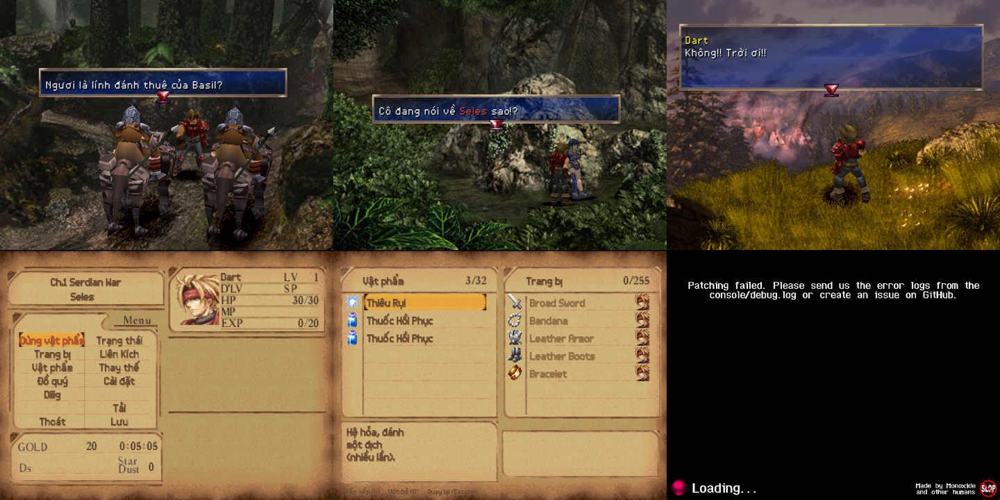

# Nghiên cứu: bản tiếng Việt The Legend of Dragoon cho Severed Chains

Ngày 16/10/2026. Nguồn: Severed Chains (SC) commit `affcef0` (14/10/2026, bản devbuild `3.0.0-1816`), mod-loader 4.3.5,
script-recompiler 0.7.11. Dữ liệu dịch: dự án `D:\LOD` (bản vá PS1 v1.9).

## Kết luận nhanh

| Hướng | Kết quả | Ghi chú |
|---|---|---|
| **(a)** Cho SC đọc thẳng 4 đĩa đã vá (`play_1210`) | **Không chạy được** (đã thử) | SC dừng ở "Patching failed": bản vá script của chính SC không khớp script đã Việt hoá. Kể cả bỏ qua được thì mọi chữ có dấu thành `?` và các bản vá mã MIPS của D:\LOD không có tác dụng. |
| **(b)** Mod SC đúng kiểu: dùng đĩa gốc + `tr/vi/*.json` + font Việt riêng | **Chạy được** (bản thử, có ảnh) | Menu/vật phẩm qua file `.lang` (không cần sửa mã); lời thoại cần **sửa nhỏ mã lõi SC** (4 lớp Java) vì SC chưa hỗ trợ dịch thoại. |
| **(c)** Đóng góp phần sửa lõi lên SC (pull request) | Đề xuất | Khi được nhận, bản Việt chỉ còn là gói dữ liệu (lang + font), không phải giữ bản sửa riêng mỗi lần SC cập nhật. |

Ảnh bản thử (đĩa gốc + bản thử tiếng Việt, PC):



## 1. Severed Chains là gì, cài đặt thế nào

- Bản dịch ngược mã MIPS của LoD sang **Java** (không phải giả lập), đồ hoạ OpenGL qua LWJGL, có API mod.
  Mã nguồn: https://github.com/Legend-of-Dragoon-Modding/Severed-Chains — giấy phép **AGPL-3.0**.
- Người chơi tải bản build (`Severed_Chains_Windows.zip`, 131 MB, mục Releases → `devbuild`), giải nén, chép ảnh đĩa vào
  `isos/`, chạy `launch.bat` (tự tải **JDK 25** Amazon Corretto 222 MB vào `jdk25/`). Không cần BIOS.
- Cần **đủ 4 đĩa bản Mỹ** (NA), dạng BIN thô 2352 byte/sector (nhận đĩa theo tên volume `SCUS94491/94584/94585/94586`,
  đọc chỉ-đọc). Tên file tuỳ ý.
- Lần chạy đầu: giải nén tài nguyên vào `files/` (máy này: 114.333 file, 1,4 GB, ~35 giây), rồi **áp ~350 bản vá script**
  (`patches/scripts.csv`): dịch ngược script → áp unified diff → dịch lại. Một bản vá không khớp là dừng hẳn.
- Có trình cập nhật tự động (nút "Update Available" ở màn tựa) — thay jar của game.

## 2. Kiến trúc chữ trong SC

### 2.1 Ba nguồn chữ

| Nguồn | Ví dụ | Dịch bằng gì | Số lượng |
|---|---|---|---|
| **File ngôn ngữ** `.lang` (Java properties, UTF-8, Unicode) | tên/mô tả vật phẩm, trang bị, đồ quý, phép, Liên Kích, trạng thái, menu SC, tùy chọn | Thả file `lang/<tên>.vi.lang`, chọn ngôn ngữ trong Tùy chọn — **không cần sửa mã** | `lod` 777 dòng, `lod_core` 445 dòng |
| **Chuỗi viết cứng trong Java** | tên quái (`Monsters.java`), địa danh menu/lưu (`SItem.java`), tên chương, địa danh bản đồ thế giới (`WmapStatics.java`), trạng thái xấu trong trận | Phải sửa mã (chuyển sang khoá `.lang`) | 344 chuỗi khác nhau (`tools/sc_hardcoded.py`) |
| **Chuỗi trong script trên đĩa** (DRGN0/1/21–24) | toàn bộ lời thoại, thông báo nhận đồ, hộp lựa chọn, chữ hướng dẫn | Phải sửa mã (SC chưa có cơ chế) | ~12,5 nghìn chuỗi khác nhau |

Hiện trạng dịch của SC: bản tiếng Ba Lan thêm ngày 13/10/2026, **chỉ menu**; mục tùy chọn ghi rõ
"Language (WIP, Menu Only) — most of the game will still display in English". Chưa có ai dịch lời thoại trên SC.

### 2.2 Mã hoá và hiển thị lời thoại

- Script gọi `addTextbox` (Text.java `scriptAddTextbox`, `scriptSetTextboxContents`; SMap.java `addSobjTextbox`);
  cả 3 chỗ đều đọc chuỗi bằng **`LodString.fromParam`** → mảng mã 16-bit LoD (giống hệt bảng mã của D:\LOD:
  `00` dấu cách … `0x56`, `A0FF` hết, `A1FF` xuống dòng, `A3FF` hộp mới, `A5xx/A7xx/A8xx/B0xx/B1xx` điều khiển).
- Khi vẽ, mỗi mã đi qua `LodString.fromLodChar` (bảng cố định 0x00–0x56 → ký tự ASCII), rồi tra font theo ký tự Unicode.
  **Mọi mã khác thành `?`** — nên mã chữ Việt 0xD0–0x159 và 193 mã glyph ghép của bản vá PS1 đều hiện `?`.
- Trình dịch ngược script (script-recompiler) biểu diễn chuỗi là `str[...]` với tag `<line>`, `<speed=0>`, `<colour=5>`,
  `<chr=0x1d0>`…; mã lạ được giữ bằng `<chr=…>` (có thể dùng để ghi mã tuỳ ý).

### 2.3 Font

- `gfx/fonts/<tên>.json` + `<tên>.png` cùng tên: `{"name", "glyphs": {"<ký tự Unicode>": {texU, texV, texW, texH, x, y, w, h, colour}}}`.
  `w` là bước chữ (renderer cộng thêm 1 px) → **VWF sẵn**. Ảnh PNG kích thước tuỳ ý. Mọi file `.json` trong thư mục hiện
  trong Tùy chọn → Giao diện → Phông chữ. Tên font cũng là khoá dịch.
- Có 2 font: **Original** (256×256, nét đậm 2 px kiểu LoD) và **Smooth** (1024×1024, vẽ ×4, là **mặc định**). Từ 13/10/2026
  cả hai có Latin-1 + Ba Lan + Thổ (à á â ã é ê ô õ ú ý…), **chưa có** ă ơ ư đ và dấu hỏi/ngã/nặng.
- Hộp thoại: mỗi dòng 12 px, glyph hiện ở hàng 1–12 của ô 16 px (hàng 0 bị cắt).

### 2.4 Hộp thoại

- Giữ đúng kiểu PS1: lưới `w` ký tự × `l` dòng; khung rộng `w × 9` px; **ngắt dòng theo số ký tự** (không theo điểm ảnh),
  dòng thừa thì cuộn. `w,l` do script truyền vào — thường là cặp `(w,l)` nằm ngay sau `A0FF` của chuỗi.
- Chữ vẽ theo bề rộng thật của glyph (VWF), nên chữ tiếng Anh chỉ lấp ~70% khung.

### 2.5 Hệ thống mod

- `mods/*.jar` (lớp có `@Mod`), bus sự kiện (~100 sự kiện: trận, vật phẩm, cửa hàng, bản đồ, nhập liệu…), registry
  (vật phẩm, trang bị, phép, cấu hình, phím…) — mỗi mục có khoá dịch.
- **Không** có cơ chế sửa mã lõi (không mixin/biến đổi bytecode), và **không có sự kiện nào cho chuỗi hộp thoại** →
  một mod `.jar` thuần không thể dịch lời thoại hay đổi cách hiển thị mã chữ.
- Ngôn ngữ: mỗi mod có `lang/<locale>.lang` riêng; ngoài ra mọi file `lang/*.<ngôn ngữ>.lang` ở thư mục game được nạp đè
  (`LangManager.loadLangOverrides`); ngôn ngữ nào có file thì hiện trong danh sách (đã thấy "Vietnamese").

### 2.6 Đồ hoạ có chữ

| Hình | Nguồn trong SC | Bản PS1 D:\LOD đã vẽ lại? |
|---|---|---|
| Menu màn tựa (New Campaign/Continue/Options/About/Quit) | ảnh riêng của SC `gfx/ui/title_menu.png` | Không (khác hẳn PS1) |
| Thẻ tiêu đề chương ("Chapter 1 Serdian War") | đĩa `DRGN0/6670–6673` | Có (`font/chapter_titles.py`) |
| Nhãn menu (GOLD, Star Dust, LV, HP…) | đĩa `DRGN0/6665` | Có một phần (`font/menu_labels.py`) |
| Nền màn tựa / ghi công | đĩa `DRGN0/5718` | Có (dòng ghi công `font/title_credit.py`) |

## 3. Đánh giá các hướng

### (a) Chạy SC trên đĩa đã vá tiếng Việt — loại

Đã thử thật (thư mục `game_a`, SC gốc, 4 đĩa `D:\LOD\play_1210\*.bin`): giải nén xong thì dừng ở màn
"Patching failed" — `PatchFailedException: could not apply patch due to CONTENT_DOES_NOT_MATCH_TARGET` khi áp
`scripts/DRGN1/254.diff` (log: `work/huong_a_stdout.txt`, `work/huong_a_debug.log`; ảnh `docs/anh/09_…png`), kèm 715 cảnh báo
"Found invalid character" (mã chữ Việt 0x158, 0x159, 0xD0…). Lý do gốc:

1. Bản vá script của SC là diff theo dòng trên script dịch ngược; script Việt hoá đổi chữ và dời chuỗi ra cuối mục → lệch.
2. Kể cả bỏ qua bản vá: `fromLodChar` biến mọi mã ngoài 0x00–0x56 thành `?`; font Việt trong VRAM của đĩa không được dùng
   (SC vẽ bằng font PNG riêng).
3. Các bản vá **mã** của D:\LOD (bước ô x*9→x*5, sprite chữ ghép 8→16 px, bảng RKERN, overlay) không có tác dụng: SC không chạy
   mã MIPS, hộp thoại là mã Java.
4. Chỉ phần **ảnh** (thẻ chương, nhãn menu, nền màn tựa) trên đĩa vá là SC dùng được — nên dùng lại riêng lẻ (xem 5.5).

### (b) Mod SC: đĩa gốc + dữ liệu dịch + font Việt — chọn

- Không đụng đĩa người chơi; dùng lại gần như toàn bộ **bản dịch** của D:\LOD.
- Menu/vật phẩm/phép: chỉ cần file `.lang`.
- Lời thoại + chuỗi viết cứng: cần sửa mã lõi SC (nhỏ, xem mục 4). Phát hành theo (c) hoặc tạm thời kèm bản sửa.

### (c) Đưa phần sửa lõi lên SC (pull request) — khuyến nghị cho lâu dài

Phần sửa là tính năng chung "dịch chuỗi script + chữ Unicode + ngắt dòng theo điểm ảnh" — có ích cho mọi ngôn ngữ (nhóm Ba Lan
đang dừng ở menu). Nếu được nhận: bản Việt = thư mục `lang/` + `gfx/fonts/`, người chơi chỉ chép vào, cập nhật SC không làm hỏng.
Nếu không: phải tự giữ bản sửa theo từng commit SC (rủi ro mục 7).

### Dùng lại được gì từ D:\LOD

| Dùng lại | Không dùng |
|---|---|
| `tr/vi/*.json` (13.264 câu thoại + 778 mục menu), `tr/en/strings.tsv` (khoá), `tr/choices.json` (hộp chọn), `tr/glossary.md` | vá EXE/overlay (`asm_main.py`, RKERN, mã ghép, ô vô hình, nén BPE) |
| quy tắc nhận tên người nói / nối dòng (`build.py`, `vtext.reflow`) | đóng gói DRGN, dời chuỗi, con trỏ (`modtext.py`, `scripttext.py`…) |
| font vẽ tay `font/base.py` + `compose.py` | PPF, `apply_patch.py`, các kiểm tra theo sector |
| ảnh đã duyệt: thẻ chương, nhãn menu, dòng ghi công | |

## 4. Bản thử đã làm (thư mục `D:\LOD-SC`)

### 4.1 Thành phần

| Thành phần | File | Ghi chú |
|---|---|---|
| Menu/vật phẩm | `tools/sc_lang.py` → `out/lang/lod.vi.lang` | 384 khoá ghép tự động theo chữ Anh với `tr/en/menu.tsv` (vật phẩm 53/54, mô tả trận 50/54, đồ quý 37/37, phép 35/35, mô tả trang bị 105/148). Tên trang bị (148) và tên Liên Kích (35) để tiếng Anh như bản PS1. 321 khoá chưa ghép: `out/lang_missing.tsv`. |
| Giao diện SC | `tr_sc/core.vi.lang` | Dịch tay ~45 khoá thử (menu trong game, Có/Không, Phông chữ, Ngôn ngữ…). |
| Lời thoại | `tools/sc_dialogue.py` → `out/lang/dialogue.vi.tsv` | 13.264 câu: `chữ Anh dạng tag ⇥ chữ Việt ⇥ kiểu`. Kiểu N (dòng đầu là tên, 7.192), J (nối dòng, 2.373), L (giữ dòng: bảng, câu có B0xx, 3.317), C (không bao giờ ngắt: hộp chọn + khung 1 dòng theo `tr/choices.json`, 382). Dòng sau tên mở bằng số chèn `{A8xx}` hoặc ngoặc kép + chữ hoa cũng là câu (`opens_sentence`, sửa 3 câu tên dài bị nối, mục 4.3 (h)). **+12 bí danh** cho câu tiếng Anh SC tự sửa (đọc thẳng `Severed-Chains/patches/scripts/**/*.diff`, thiếu/thừa thì dừng). |
| Font | `tools/sc_font.py` → `out/fonts/vietnamese.json/.png` | 315 glyph, 212 lấy từ font vẽ tay D:\LOD (đặt ở hàng 1–12 của ô 16 px), ký hiệu/biểu tượng nút lấy từ font Original. Xem trước: `docs/anh/10_font_xem_truoc.png`. |
| Sửa lõi SC | `sc-vi/src/…` → `out/sc-vi.jar` | Diff gọn `sc-vi/patches/sc-core-affcef0.diff`, tạo lại tự động bằng `tools/sc_core_diff.py` (`--check` để so). |
| Tự kiểm | `sc-vi/test/TagRoundTrip.java` | 13.276 câu × (khoá tag 2 cột + ngắt dòng 6 bề rộng × 2 kiểu đo + **bố cục như trong game** qua `lookup`/`layout` với 2 khung, kiểu N giữ nguyên dòng tên) + 7 ca riêng (Funds, hộp "DÙNG CỬA HÀNG?", bí danh Lisa/S08018/S10558/S02777 đúng khoá thấy trong game, `<action>`, hộp chọn số "Hủy" khung 6, dòng tên Quầy Diệt Quái/Lapto 5 đứng riêng): **0 lỗi**. Thử ngược: đổi C→L thì báo lỗi hộp cửa hàng; bảng cũ (Quầy Diệt Quái kiểu J) báo "DONG TEN bi noi". |
| Build / chạy | `tools/build_sc_vi.ps1`, `tools/run_sc.ps1 -Install`, `tools/sc_ui.ps1` (bấm phím/chụp cửa sổ game SDL) | Dữ liệu sinh ra xác định (build 2 lần cùng SHA-256). |
| Tới cảnh/trận | `tools/sc_cuts.py` (uid/vị trí script → số cảnh, từ `SUBMAP/NEWROOT.RDT`), `tools/sc_dbg.ps1` (điều khiển cửa sổ Debugger F12 qua UI Automation: `-Warp <cảnh>`, `-Encounter <trận>`, `-GetMap`; cửa sổ con GameState Editor: `-Flag2`/`-Flag1 "e1=1,fe=0"`, `-ShowFlag2`/`-ShowFlag1`, `-Chapter`; Submap Debugger: `-SobjNear <npc>` dời NPC tới cạnh người chơi, `-SobjPos "0:x,y,z"`, `-ShowPlayer`) | Save: chép thẻ nhớ PS1 (`D:\LOD\work\card_d*.mcd`, `release\epsxe000.mcr`) vào `game\saves`, SC tự đổi sang chiến dịch ở màn tựa (chọn **Không** xoá thẻ). `card_d3/d4` là **thẻ mẫu** (LV1, mọi cờ = 0, chỉ đổi cảnh): cảnh phụ thuộc cờ phải đặt cờ (xem "Bẫy khi tới cảnh" ở 4.3). |

### 4.2 Phần sửa lõi SC (so với commit `affcef0`)

1. `LodString` (+8 dòng): mã `0x10000 + ký tự Unicode` mang chữ ngoài bảng gốc (`fromLodChar` trả lại ký tự); `fromParam` gọi
   bộ dịch.
2. `ScriptTextTranslations` (mới): nạp `lang/dialogue.<ngôn ngữ>.tsv` theo ngôn ngữ đang chọn; tính khoá từ mảng mã giống
   hệt `codes_to_text` của `D:\LOD\tools\dump.py`; mã hoá chữ Việt; câu không có bản dịch giữ nguyên tiếng Anh, có thể ghi ra
   `dialogue_missing.vi.txt` (`-Dscvi.logMissing=true`). Bản dịch là lớp con `Translated` của `LodString`, giữ chuỗi gốc
   (`original()`), khoá và kiểu để **ngắt lại theo khung thật** lúc chuỗi được đặt vào hộp (`applyGrid`/`layout`):
   - **ngắt theo điểm ảnh** của font đang chọn trong bề rộng khung gốc `w × 9` px, `w` = số script truyền cho addTextbox (trước đây
     đoán từ 2 word sau chuỗi — không phải chuỗi nào cũng có);
   - kiểu **C** (hộp chọn, khung 1 dòng) không bao giờ ngắt — vạch chọn và lựa chọn trả về đi theo số dòng; dòng dài hơn khung thì
     **nới khung** (tối đa 34 ô) như bản PS1. Trước khi sửa: "DÙNG CỬA HÀNG?" (khung 10 ô) bị ngắt thành 4 dòng → vạch chọn lệch 1 dòng
     và chọn "DÙNG" ra "KHÔNG DÙNG"; 7 hộp chọn bị ảnh hưởng (S02077, S04508, S07817, S10055, S10954, S10983, S11023);
   - số chèn `{A8xx}`: khi ngắt tính chỗ 3 chữ số (1 chữ số/mã khi liền nhau như `{A800}{A801}…`), lưới chừa 10 ô (đủ 10 chữ số của
     `digits_46`) — trước đây số không chiếm chỗ nên dòng có số có thể bị engine tự ngắt giữa số;
   - mã nút `<action=lod:…>` của SC (`C0LL` + tên đóng gói): không bị tách khi ngắt, chiếm 1 ô lưới, đo bằng 6 chữ số.
3. `Text.java` (+4/−2) và `SMap.java` (+10/−9): gọi `applyGrid(hộp, chữ)`; nới **lưới ký tự** (`chars_1c`), còn **vị trí/bề rộng
   khung** tính theo khung (`chars_18`, chỉ đổi khi kiểu C phải nới); hack quán trọ `"?Funds ?G"` của SC so với **chuỗi gốc** của bản
   dịch (trước đây hack không chạy với chữ Việt).
4. Đã kiểm: biên dịch bản **chưa sửa** của `Text`/`LodString` từ mã nguồn ra đúng từng lệnh như lớp trong jar build; `SMap` chỉ
   khác cách lưu một hằng số → mã nguồn khớp bản build. Diff áp sạch lên clone SC `affcef0` (`git apply --check`).

**Bí danh 12 câu SC tự sửa** (`tools/sc_dialogue.py`): đọc cặp `-data str[…]`/`+data str[…]` trong `patches/scripts`, đổi tag SC sang
tag bảng (`<line>` `{n}`, `<multibox>` `{p}`, `<speed=0>` `{A500}`, `<colour=5>` `{A705}`, `` ` `` `{000E}`, `□` `{0056}`,
`<action=lod:x>` `{C0LL}` + tên), ghi thêm dòng khoá-SC → chữ Việt (`SC_VI_FIX`: "nút {000E}" → `<action>`, bỏ dấu cách thừa
" he Mayor"/" gainst"/" Is this civil war!? ", "?" → "Hủy" ở hộp chọn số). Bẫy: script-recompiler đóng 2 mã/word nên phần `<noterm>`
lẻ mã được **đệm `0x00`** — câu Lisa (DRGN22/1137, "Vally" → "Valley") trong game là "to␣␣find" hai dấu cách; chỉ bắt được nhờ
`dialogue_missing.vi.txt`, đã thêm vào tự kiểm.

### 4.3 Kết quả trong game (đĩa gốc, ảnh trong `docs/anh/`)

- Tùy chọn: chọn **Ngôn ngữ = Vietnamese**, **Phông chữ = Tiếng Việt (pixel)** (`08_…`).
- Cảnh mở đầu → rừng → lính Sandora → Rồng Nanh Xanh → Rose → Seles cháy: mọi hộp thoại tiếng Việt có dấu, tên người nói màu vàng,
  mã màu đỏ (`{A705}` "Rồng", "Seles"), ngắt dòng trong khung gốc (`02…05`). Trong vài chục hộp thoại đã qua, câu thiếu bản dịch duy
  nhất (theo `dialogue_missing.vi.txt`) là `{B001}...?` — giống hệt bản gốc, không cần dịch.
- Menu trong game và danh sách vật phẩm tiếng Việt (`06`, `07`): "Thiêu Rụi", "Thuốc Hồi Phục", "Hệ hỏa, đánh một địch (nhiều lần).";
  trang bị giữ tiếng Anh.
- Thấy ngay việc phải làm tiếp: "Dùng vật phẩm" tràn ô menu; "Ch.1 Serdian War / Seles", "Diiig" và chữ ảnh GOLD/Star Dust
  vẫn tiếng Anh; thẻ "Chapter 1 Serdian War" là ảnh gốc.

**Phiên kiểm các kiểu hộp (16–17/10/2026, bản đã sửa ở 4.2)** — save chuyển từ thẻ PS1 + Debugger F12 (`sc_dbg.ps1`):

| Kiểu | Cảnh | Kết quả | Ảnh |
|---|---|---|---|
| (a) Trận đánh | trận 0 (berserk_mouse), trận 431 (Lavitz linh hồn, Mặt Trăng) | Thoại trong trận (DRGN1) tiếng Việt, ngắt trong khung trận ("Cậu quên chuyến đi của chúng ta rồi sao!? / Tớ không muốn đánh cậu! Tỉnh lại đi! / Lavitz!!"). Ghi nhận, chưa sửa: nhãn lệnh "Attack", HP/MP/SP, tên chiêu "Double Punch", màn kết quả GOLD/EXP./ITEMS vẫn tiếng Anh (chuỗi viết cứng/ảnh của SC) | `11` |
| (b) Hộp chọn có vạch | trong trận ("Lavitz! / Gọi cậu ta / Mặc kệ"), quán trọ cảnh 146, cửa hàng cảnh 530 | Vạch chọn đúng dòng; chọn dòng 2 và dòng 3 đều chạy đúng nhánh (ở trọ → trừ 20G; "DÙNG" → hỏi "DÙNG CỬA HÀNG NÀO?"; "Mặc kệ" → không thoại) | `12`, `13`, `14` |
| (c) Quán trọ / cửa hàng | quán trọ 146 (99.858.017 vàng), Lapto cảnh 530 | "Tiền 99858017G" một dòng (8 chữ số, hack Funds chạy); danh sách mua tiếng Việt. Màn cửa hàng Buy/Sell/Carried/Leave, Items/Gold, "Carrying" là menu Java của SC chưa dịch (thuộc mục 5.4) | `13`, `14` |
| (d) Hộp theo NPC (`positionSobjTextbox`) | Lapto cảnh 530 | Cả hai nhánh: khung rộng (≥ 17 ô) căn giữa ("Lapto Cửa Hàng / ĐIỀU LUẬT WINGLY…"), khung hẹp đặt cạnh NPC và được nới cho vừa ("DÙNG CỬA HÀNG?") | `14` |
| (e) Đĩa 2 / bí danh | Fletz cảnh 702 (Lisa), gian trò chơi cảnh 636 | Cả cảnh Lisa tiếng Việt (tên người nói, câu dài cuộn trong khung). Câu bí danh có `<action>`: "…nhấn nút **Space** để chọn." (SC tự điền phím). Lỗi bí danh câu Lisa (hiện tiếng Anh) đã sửa, chụp lại | `15`, `16` |

**Phiên kiểm đĩa 3–4 và hộp hiếm (17/10/2026)** — save đĩa 3 `card_d3`, đĩa 4 = save chương 4 thật ("New Campaign 3", Unknown location 1):

| Kiểu | Cảnh | Kết quả | Ảnh |
|---|---|---|---|
| (f) Đĩa 3 + bí danh S08018, S10558 | Furni cảnh 329 (Hiệp sĩ trú đóng Harris, Bulgus, ~15 hộp), NPC Furni; Vellweb cảnh 502 | Thoại tiếng Việt, tên vàng, mã màu đỏ ("Rừng Thường Xanh"). S08018 là lời NPC 11 ở giai đoạn "có Rồng" (cờ flags2 0xe1, 0xf5 bật, 0xfe tắt), lần nói thứ hai: "Trước Rồng, chúng ta chẳng làm gì được." — bí danh của câu SC sửa " gainst" (khung SC nới 25→26 ô) tra đúng, không dấu cách thừa. S10558 tự chạy khi vào cảnh 502 (flags2 0x11c tắt, một trong flags1 0xbe–0xc1 bật): "Rose / Đi tiếp thôi. Giờ không có lý do để ở đây." (SC bỏ "Rose" lặp) | `17`, `18` |
| (g) Đĩa 4 | mở đầu Death Frontier (cảnh 746), Zenebatos cảnh 529 | ~20 hộp tiếng Việt, tên vàng, mã màu ("Thành Phố Luật Pháp Zenebatos", "Ulara"), số "10.000" giữ đúng | `19` |
| (h) Số chèn `{A800}…{A805}` | Quầy Trò Chơi Diệt Quái cảnh 152 (Lohan) | Ô điểm 6 ô "000000" như bản gốc (6 biến, mỗi biến 1 chữ số). **Lỗi đã sửa**: màn kết quả hiện "Quầy Trò Chơi Diệt Quái 000000 điểm! Lại tới nhé!!" trên **một dòng** — tên quầy bị nối vào câu vì dòng 2 bản Anh mở bằng số chèn (không phải chữ hoa) và tên dài 27 > 24 ký tự nên `is_name` xếp kiểu J. Sửa `sc_dialogue.py` (`opens_sentence`: số chèn `{A8xx}` hoặc ngoặc kép + chữ hoa cũng mở câu) → đúng 3 câu đổi sang kiểu N: S02757 (quầy), S11045 ('Lapto Trung Tâm Lập Pháp 5 / "NGƯỜI CÓ GIẤY PHÉP…"'), S12214 ('Sự kiện / "Rose giới thiệu…"'). Sau sửa: "Quầy Trò Chơi Diệt Quái / 000000 điểm! Lại tới nhé!!" | `20` (trái: trước, phải: sau) |
| (i) Hộp chọn số 1–5 "Hủy" | khoá số Đền Shirley cảnh 157 (S02777, khung 6 × 8) | Cả cảnh Lavitz/Dart tiếng Việt; hộp "1 2 3 4 5 Hủy" (bí danh của câu SC sửa "?" → "Cancel"), khung giữ 6 ô; vạch chọn đúng dòng ở "1" và "Hủy"; chọn "Hủy" chạy đúng nhánh của bản gốc ("Dart / Chắc sai rồi.") | `21` |

Sau các phiên trên, `dialogue_missing.vi.txt` chỉ còn: `{B001}...?` và `...` (giống bản gốc), `{B000}{A800}…{A805}` (ô điểm Quầy
Diệt Quái, chỉ có số), `dummy_C071_0_21` (chữ giữ chỗ trong script quán trọ cảnh 71 khi vào bằng Warp). Cùng quy tắc nhận tên
có trong `build.py` của D:\LOD → bản PS1 có thể cũng nối tên ở 3 câu (h) (chưa kiểm trên PS1).

**Bẫy khi tới cảnh** (ghi lại để kiểm tiếp):
- Script cảnh đọc cờ cốt truyện: flags2 = `scriptReadGlobalFlag2` (ô "Script Flags 1" của GameState Editor — SC đặt tên ngược),
  flags1 = `scriptReadGlobalFlag1` (ô "Script Flags 2"). Tìm cờ cần bật bằng cách dịch ngược script của cảnh với
  script-recompiler có sẵn trong `game\libs` (chạy trong thư mục có `cache\meta` = bản sao `game\patches\meta`):
  `java -cp "game/libs/*" org.legendofdragoon.scripting.Shell d -v meta -i game/files/SECT/DRGN23.BIN/12/1 -o x.txt`
  (thư mục script = thư mục cảnh + 2; tệp 0 = điều khiển cảnh, thường đếm cờ trong bảng `LABEL_x` để ra "giai đoạn").
- NPC bản đồ: bảng thoại theo (giai đoạn × số sobj + số sobj của NPC) → (cờ "đã nói", câu đầu); lần nói thứ hai là câu kế.
  NPC đứng chỗ khó tới: `sc_dbg.ps1 -SobjNear <số sobj>` dời NPC tới cạnh Dart (NPC đứng yên giữ vị trí).
- `card_d4` nạp xong kẹt màn đen ở cảnh 510 (thẻ mẫu, cờ 0); Warp không nhận khi bản đồ chưa vào trạng thái hiển thị.
- Warp dùng điểm vào 0: điểm 0 của cảnh 157 nằm trên lối ra → bị chuyển ngay sang 154 cảnh 12. Vào đúng: ở cảnh 154 đặt Dart
  lên ô lối ra dẫn sang 157 (bảng `collisionAndTransitions` của `NEWROOT.RDT`: ô 6 → cảnh 157; vùng ô tính từ tệp va chạm
  `DRGN21/466/1`), rồi `-SobjPos` vào ô khoá (ô va chạm 0x34, tệp `DRGN21/475/1`).
- Cảnh có bản "cuối game" (`lateGameFile` trong NEWROOT, ví dụ khu đền đĩa 1 ↔ DRGN22): SC chọn theo chương và đĩa hiện tại, save
  chương 4 vào bản cuối (không có khoá số) → `sc_dbg.ps1 -Chapter 0` trước khi Warp (không lưu game sau đó).

## 5. Kế hoạch đề xuất

1. **Hướng phát hành**: đã chốt tự phát hành ghim SC `affcef0` (xem `PHAT_HANH.md`, `tools/make_release.py`); liên hệ nhóm SC
   (Discord #modding / GitHub) giới thiệu tính năng dịch thoại vẫn là lựa chọn lâu dài.
2. **Hoàn thiện lõi** — đã xong phần lớn (mục 4.2–4.3): bí danh 12 câu SC, hộp chọn (kiểu C), số chèn `{A8xx}`, hack Funds, hộp 1 dòng,
   hộp theo NPC, chữ trong trận, ngắt theo khung thật, đĩa 3–4, số chèn Quầy Diệt Quái, hộp chọn số "Hủy". Còn: tự nhận font Việt khi chọn tiếng
   Việt (font Smooth mặc định không có dấu); đặt tên font không dấu cho danh sách chọn. Mỗi lần SC đổi `patches/scripts`,
   `sc_dialogue.py` dừng nếu số câu đổi khác 12 → cập nhật `SC_VI_FIX`.
3. **Chuỗi viết cứng** (1 phiên + dịch tay phần thiếu): đổi 344 chuỗi trong 6 file Java sang khoá `.lang` (đúng hướng SC đang đi:
   vật phẩm đã chuyển), ghép tên quái/địa danh từ `D:\LOD tr/vi` (M-uid), phần còn lại dịch tay theo `tr/glossary.md`.
4. **Giao diện SC** (~700 khoá `lod_core` + `lod` còn thiếu): dịch, rồi kiểm bề rộng từng ô menu SC (như `check_menu.py` của PS1),
   ví dụ "Dùng vật phẩm" → câu ngắn hơn.
5. **Đồ hoạ**: dùng lại ảnh đã duyệt của PS1 (thẻ chương, nhãn menu, dòng ghi công) — SC nạp chúng từ `files/SECT/DRGN0.BIN/…`
   nên cần một bước thay file sau giải nén hoặc móc thay texture trong lõi; vẽ lại `gfx/ui/title_menu.png` của SC.
   Theo quy trình: ảnh xem trước gốc/Việt → bạn duyệt → áp.
6. **Font** (tuỳ câu hỏi 2): giữ font mảnh PS1, và/hoặc vẽ dấu Việt cho font Original đậm, và/hoặc bản Smooth ×4.
7. **Chơi thử toàn bộ** bằng `-Dscvi.logMissing=true` + `tools/sc_ui.ps1` + `tools/sc_dbg.ps1 -Warp` (tra cảnh bằng `sc_cuts.py`),
   chụp ảnh các cảnh. Kiểm kiểu `text_audit.py` (ngắt bằng đúng hàm Java, dòng tràn/số dòng/hộp chọn) đã nằm trong `TagRoundTrip`
   (phần bố cục như trong game); còn thiếu bề rộng khung thật theo từng câu (hiện thử 2 khung giả định: dòng Anh dài nhất và +4).
8. **Phát hành**: (c) PR lên SC rồi phát hành gói dữ liệu; hoặc gói `sc-vi` (jar + lang + font + `launch-vi.bat`, mã nguồn công khai
   theo AGPL), ghim đúng commit SC, kiểm commit khi khởi chạy.

## 6. Khối lượng ước tính

| Phần | Khối lượng | Ghi chú |
|---|---|---|
| Lời thoại | Nhỏ (đã có 100% bản dịch, đã chạy) | Chủ yếu là kiểm thử theo cảnh |
| Menu vật phẩm/phép | Nhỏ (384 khoá tự động) | |
| Giao diện riêng SC | Trung bình (~700 khoá dịch tay) | nhiều mục cấu hình kỹ thuật |
| Chuỗi viết cứng | Trung bình (sửa 6 file Java + 344 chuỗi) | cần sửa lõi |
| Đồ hoạ | Trung bình | đã có ảnh PS1 + vẽ menu tựa SC |
| Font đậm / Smooth | Trung bình (nếu chọn) | |
| Duy trì theo SC | **Lớn nếu tự giữ bản sửa**, nhỏ nếu PR được nhận | SC ra devbuild gần như hằng ngày |

## 7. Rủi ro

- **SC thay đổi liên tục** (3.0 đang phát triển, updater tự động). Bản thử thay nguyên lớp `Text`/`SMap`/`LodString`: SC cập nhật
  mà vẫn nạp lớp cũ có thể sai hoặc sập → phải áp lại diff và build theo từng commit; `build_sc_vi.ps1` đã chặn khi jar khác commit.
- **Khoá tra = chữ tiếng Anh**: SC sửa câu tiếng Anh thì câu đó hiện tiếng Anh → đã có bí danh tự đọc `patches/scripts` (12 câu,
  dừng build khi số câu đổi) + log thiếu; câu SC sửa ở chỗ khác (mã Java) vẫn chỉ bắt được bằng log.
- **Lưới rộng hơn khung**: đã kiểm hộp thoại thường, chọn, số, trận, cuộn, theo NPC, đĩa 1–4 (mục 4.3); còn các hộp chưa đi qua khi
  chơi thử toàn bộ (mục 5.7).
- **Nhận dòng tên theo quy tắc** (`is_name`): sai thì tên bị nối vào câu (đã gặp 3 câu, mục 4.3 (h)); tự kiểm chỉ bắt được khi đã
  biết câu — chơi thử toàn bộ vẫn cần.
- **Font**: font mặc định của SC (Smooth) không có dấu Việt; người chơi phải chọn font Việt (nên tự đặt khi chọn tiếng Việt).
- **Giấy phép AGPL-3.0**: phát hành lớp sửa thì phải công khai mã nguồn (cùng giấy phép).
- PR có thể không được nhận hoặc nhóm SC muốn thiết kế khác (ví dụ khoá theo vị trí script thay vì chữ Anh).

## 8. Câu hỏi cần bạn chốt

1. **Phát hành**: gửi phần sửa lõi lên nhóm SC (PR — cần tài khoản GitHub/Discord của bạn để trao đổi) hay tự phát hành bản sửa kèm
   (mã nguồn công khai theo AGPL)?
2. **Font**: dùng font mảnh của bản PS1 (đang dùng trong bản thử) hay vẽ dấu Việt cho font đậm Original của SC; có cần bản Smooth
   độ phân giải cao (mặc định của SC)?
3. **Khung thoại**: giữ bề rộng khung gốc và ngắt theo điểm ảnh như bản thử (giống lựa chọn ở PS1) — đồng ý?
4. **Đồ hoạ**: dùng lại ảnh đã duyệt của PS1 (thẻ chương, nhãn menu, dòng ghi công) và vẽ lại menu màn tựa riêng của SC?
5. **Giao diện SC** (~700 chuỗi, nhiều mục cấu hình đồ hoạ/âm thanh/phím): dịch hết hay giữ tiếng Anh phần cấu hình nâng cao?
6. **Tên riêng**: giữ như PS1 (tên người, tên trang bị, tên Liên Kích tiếng Anh; địa danh/vật phẩm/phép tiếng Việt) — đồng ý áp y hệt?
7. **Repo**: tạo repo riêng (private) cho `D:\LOD-SC` không?

## 9. Phụ lục — đường dẫn và lệnh

```
D:\LOD-SC\
  NGHIEN_CUU.md            báo cáo này
  Severed-Chains\          clone SC (git riêng, không commit vào repo này)
  deps\                    clone mod-loader, script-recompiler (đọc mã)
  game\                    bản build SC + JDK 25 + isos\ (hard link 4 BIN gốc từ D:\LOD) + files\ (giải nén 1,4 GB)
  game_a\                  thử hướng (a): isos\ = hard link đĩa play_1210 (đã xoá files\)
  sc-vi\src, test, patches mã sửa lõi + tự kiểm + diff so với affcef0
  tools\                   sc_lang.py, sc_dialogue.py, sc_font.py, sc_hardcoded.py, sc_core_diff.py, build_sc_vi.ps1, run_sc.ps1,
                           sc_ui.ps1, sc_dbg.ps1 (Debugger F12), sc_cuts.py (số cảnh), make_release.py
  tr_sc\core.vi.lang       giao diện SC dịch tay (thử)
  out\                     sản phẩm build (lang, fonts, sc-vi.jar)
  docs\anh\                ảnh trong game
  work\                    ảnh chụp thô, log hướng (a)
```

- Mã SC liên quan: `legend/game/types/LodString.java` (`fromParam`, `fromLodChar`), `legend/game/Text.java`
  (`scriptSetTextboxContents`, `scriptAddTextbox`, `clearTextboxText`, `renderTextboxText`, `calculateAppropriateTextboxBounds`),
  `legend/game/submap/SMap.java` (`addSobjTextbox`, `positionSobjTextbox`), `legend/core/font/*` (font),
  `legend/game/modding/coremod/config/LanguageConfigEntry.java`, mod-loader `i18n/LangManager.java` (nạp `.lang`),
  `legend/game/unpacker/scripts/ScriptPatcher.java` (bản vá script).
- Dựng + cài + chạy bản thử:

```bash
powershell -ExecutionPolicy Bypass -File tools/build_sc_vi.ps1
```

```bash
powershell -ExecutionPolicy Bypass -File tools/run_sc.ps1 -Install
```

  Trong game: Options → Global Options → User Interface → Phông chữ = "Tiếng Việt (pixel)", Ngôn ngữ = Vietnamese.
- Phím SC: mũi tên di chuyển, Enter/Space xác nhận, Escape quay lại, E mở menu, Enter hai lần bỏ qua phim.
