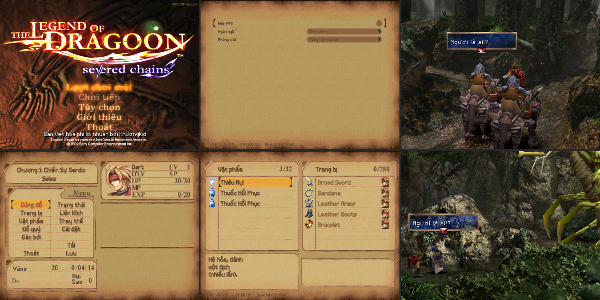
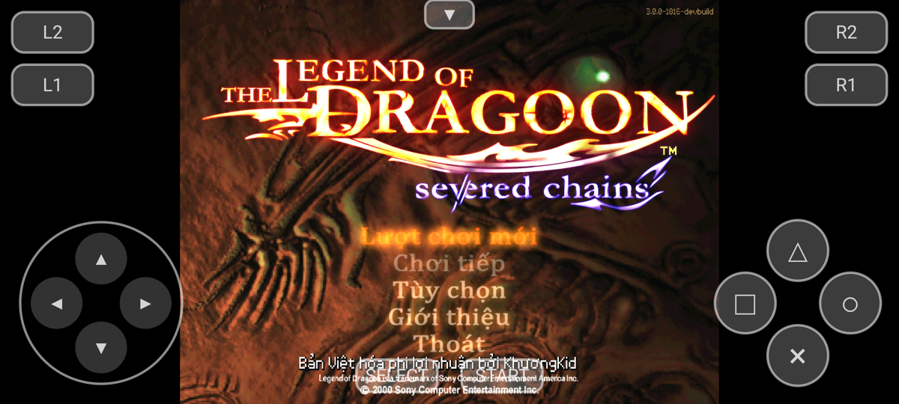
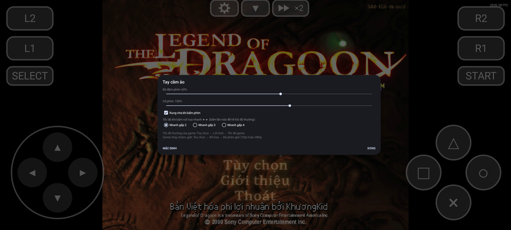
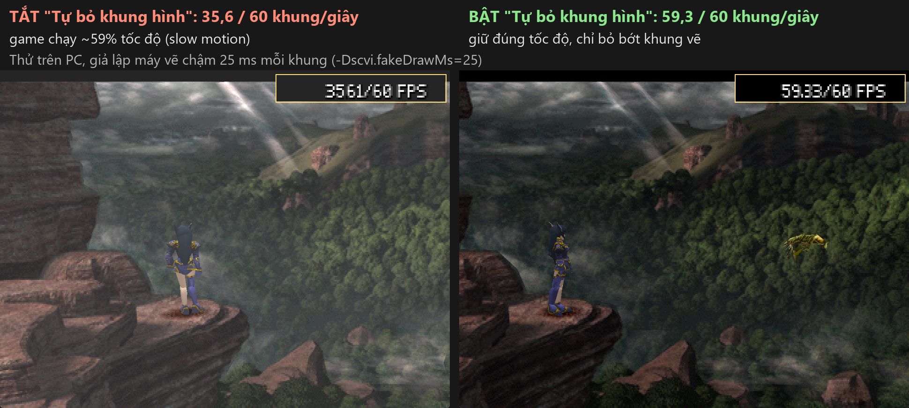
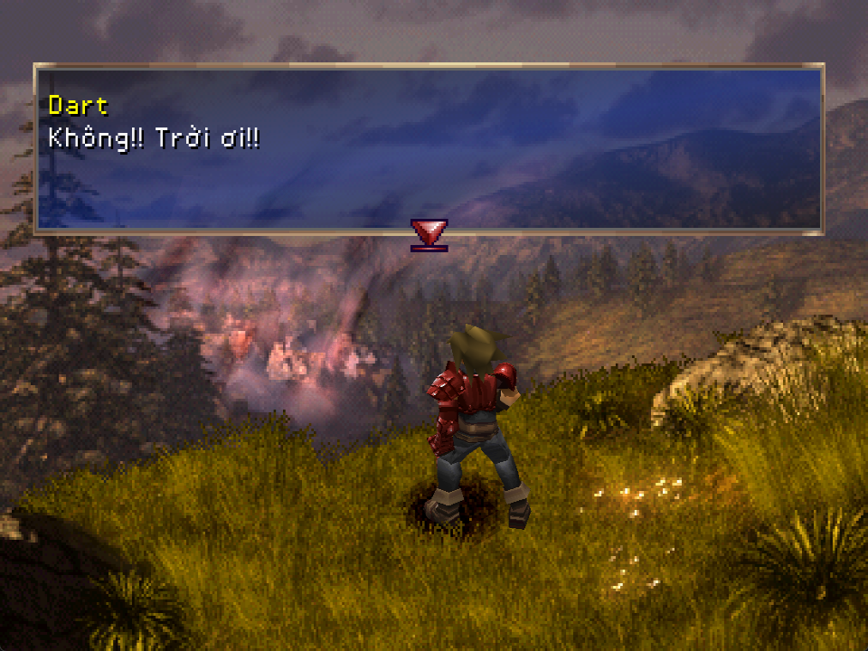

# The Legend of Dragoon — Tiếng Việt (Severed Chains)

Bản Việt hoá **phi lợi nhuận** của người hâm mộ cho The Legend of Dragoon, chạy trên
[Severed Chains](https://github.com/Legend-of-Dragoon-Modding/Severed-Chains), bản PC viết lại bằng Java của cộng đồng
Legend of Dragoon Modding. Bản dịch dùng chung với bản vá tiếng Việt cho máy PS1, có chỉnh lại cho giao diện riêng của Severed
Chains. Có bản cho **Windows** và bản thử nghiệm cho **Android**.



> Gói cài **không chứa dữ liệu game**. Bạn cần **4 đĩa gốc bản Mỹ của chính bạn** (file `.bin`, mã SCUS-94491 / 94584 /
> 94585 / 94586). Dùng đĩa gốc, **không** dùng đĩa đã vá tiếng Việt bản PS1.

## Tải về

| Nền tảng | Bản | Tệp | Ghi chú |
|---|---|---|---|
| Windows 64-bit | [v0.3](https://github.com/2ez4gcx/legend-of-dragoon-severed-chains-vi/releases/tag/v0.3-sc-affcef0) | `LoD-SC-VN-v0.3-sc-affcef0-windows.zip` (133 MB) | Đã gồm Severed Chains |
| Android 10+ (arm64) | [v0.3 Android](https://github.com/2ez4gcx/legend-of-dragoon-severed-chains-vi/releases/tag/v0.3-android-sc-affcef0) | `LoD-SC-VN-v0.3-android-arm64.apk` (200 MB) | Thử nghiệm, cần OpenGL ES 3.2 |

Mã kiểm tra SHA-256 nằm trong tệp `SHA256SUMS*.txt` đính kèm mỗi bản phát hành. Cả hai bản đều ghim Severed Chains commit
`affcef0` (devbuild 3.0.0-1816).

## Cài đặt trên Windows

1. Tải `LoD-SC-VN-v0.3-sc-affcef0-windows.zip` và giải nén cả thư mục `Severed Chains (VN)`. Đường dẫn không chứa dấu `;`,
   không để trong `Program Files`.
2. Chép 4 file `.bin` đĩa gốc vào thư mục `isos`.
3. Chạy **`launch-vi.bat`**. Lần đầu, Severed Chains tự tải Java 25 (khoảng 220 MB) và giải nén tài nguyên từ đĩa (khoảng 1,4 GB).
4. Ngôn ngữ và phông chữ đã đặt sẵn tiếng Việt. Hướng dẫn chi tiết: `HUONG_DAN_VIET_HOA.txt` trong gói.

Không bấm cập nhật Severed Chains: bản Việt hoá ghim theo một bản dựng cố định, cập nhật sẽ làm mất phần tiếng Việt (từ v0.2
nút cập nhật đã được tắt).

## Cài đặt trên Android (thử nghiệm)



1. Chép 4 file `.bin` vào điện thoại (ví dụ thư mục Download). Cần khoảng 2,4 GB cho đĩa và khoảng 2 GB cho ứng dụng.
2. Cài `LoD-SC-VN-v0.3-android-arm64.apk` (cho phép "cài ứng dụng không rõ nguồn" nếu máy hỏi).
3. Mở **LoD tiếng Việt**, bấm **CHỌN 4 ĐĨA GỐC (.BIN)** và chọn cùng lúc cả 4 file (nhấn giữ file đầu để chọn nhiều), rồi
   bấm **CHƠI**. Lần đầu game giải nén tài nguyên từ đĩa mất vài phút.
4. Điều khiển bằng tay cầm ảo trên màn hình hoặc tay cầm Bluetooth; nút Quay lại của Android là ○. Hàng nút giữa phía trên:
   **⚙** chỉnh độ đậm, cỡ phím, rung khi bấm; **▼** ẩn/hiện phím; **▶▶** tua nhanh (bấm lần nữa để về tốc độ thường).

Khuyến nghị máy có từ 6 GB RAM. Đừng di chuyển hay xoá file đĩa sau khi đã chọn. Đang có bản cũ thì cài đè, đĩa và bản lưu
được giữ. Chi tiết và lưu ý: ghi chú của
[bản Android](https://github.com/2ez4gcx/legend-of-dragoon-severed-chains-vi/releases/tag/v0.3-android-sc-affcef0).



## Tốc độ và hiệu năng

- **Tốc độ game**: Tùy chọn → Tùy chọn chung → Lối chơi → "Tốc độ game" (Bình thường, Nhanh gấp 2, 3, 4; nhạc nền giữ
  nguyên).
- **Tự bỏ khung hình khi máy chậm** (Đồ họa, mặc định bật): Severed Chains chạy logic game một lần mỗi khung vẽ ra, nên máy vẽ
  không kịp thì cả game chậm như quay chậm; tùy chọn này bỏ bớt khung vẽ bị trễ để game giữ đúng tốc độ.
- **Độ phân giải** (Đồ họa): điện thoại tự đặt 720p ở lần chạy đầu của bản v0.3; máy yếu chọn 480p.



## Đã dịch những gì



- Toàn bộ lời thoại, tên người nói, hộp lựa chọn, ngắt dòng theo độ rộng khung thoại thật của game.
- Vật phẩm, phép, mô tả, menu trong game, cửa hàng, trận đánh (Tấn công, Phòng thủ, Vật phẩm, Đổi Liên Kích, Chạy trốn…).
- Giao diện riêng của Severed Chains: tạo lượt chơi, tùy chọn, danh sách lượt chơi và bản lưu.
- Tên quái, địa danh, tên chương, trạng thái; thẻ bản lưu hiện địa danh tiếng Việt.
- Chữ vẽ trong ảnh: menu màn tựa, Vàng, Bụi Sao, nhãn menu, thẻ tiêu đề chương, tên vùng trên bản đồ thế giới, nhãn "Vàng" /
  "Vật phẩm" ở màn kết quả trận (từ v0.3).

**Còn tiếng Anh**: tên người, tên trang bị, tên Liên Kích (giữ như bản PS1); các nhãn viết tắt HP/MP/SP/LV/D'LV/EXP; chữ
trong phim.

## Câu hỏi thường gặp

- **Game báo "Please place US ISOs/BINs in "isos" directory"**: chưa có đủ 4 đĩa bản Mỹ trong `isos` (Windows) hoặc chưa chọn
  đủ 4 file (Android). Đĩa bản châu Âu/Nhật và đĩa đã vá tiếng Việt bản PS1 không dùng được.
- **Muốn chọn lại đĩa trên Android**: Cài đặt → Ứng dụng → LoD tiếng Việt → Bộ nhớ → Xoá dữ liệu (sẽ giải nén lại từ đầu).
- **Game chạy chậm như quay chậm, giật**: dùng bản v0.3 trở lên, giữ bật "Tự bỏ khung hình khi máy chậm" và hạ Độ phân giải
  (Tùy chọn → Tùy chọn chung → Đồ họa) xuống 720p hoặc 480p. Bật "Hiện FPS" (Giao diện) để xem số khung hình mỗi giây.
- **Bản lưu chuyển từ thẻ nhớ PS1 bị đen màn khi nạp**: Severed Chains gốc cũng bị như vậy, không do bản Việt hoá.
- **Báo lỗi dịch hoặc lỗi chạy**: mở [Issues](https://github.com/2ez4gcx/legend-of-dragoon-severed-chains-vi/issues), ghi rõ cảnh,
  câu thoại và (nếu là Android) tên máy.

## Cho người phát triển

- [NGHIEN_CUU.md](NGHIEN_CUU.md): kiến trúc chữ, phông và mod của Severed Chains; các hướng đã đánh giá.
- [PHAT_HANH.md](PHAT_HANH.md): nội dung gói, cách dựng (`python tools/make_release.py --version <ver>`), thử cài sạch
  (`tools/test_cai.ps1`), đổi sang commit Severed Chains mới.
- [android/README.md](android/README.md): kiến trúc và cách dựng bản Android (APK dựng không cần Gradle).
- `sc-vi/`: các lớp sửa mã Severed Chains (diff ở `sc-vi/patches/sc-core-affcef0.diff`); `tools/`: công cụ dựng dữ liệu tiếng
  Việt; `release_notes/`: ghi chú từng bản; `docs/anh/`: ảnh chụp trong game.

Dựng bản thử (cần thư mục `game` là bản dựng Severed Chains commit `affcef0` + JDK 25, và dự án bản vá PS1 `D:\LOD` đặt cạnh
thư mục này):

```bash
powershell -ExecutionPolicy Bypass -File tools/build_sc_vi.ps1
```

```bash
powershell -ExecutionPolicy Bypass -File tools/run_sc.ps1 -Install
```

## Giấy phép và ghi công

- Severed Chains © nhóm Legend of Dragoon Modding, giấy phép **GNU AGPL-3.0**. Phần sửa mã trong `sc-vi/` và bản Android phát sinh
  từ mã Severed Chains nên cũng theo AGPL-3.0 ([LICENSE](LICENSE)). Mã nguồn đi kèm trong mỗi gói (`vi/NGUON/`).
- Java 25 trong bản Android: bản dựng OpenJDK của dự án Amethyst/AngelAuraMC (GPLv2 + Classpath Exception).
- The Legend of Dragoon © Sony Interactive Entertainment. Đây là bản dịch phi lợi nhuận của người hâm mộ, không bán, không kèm
  dữ liệu game; vui lòng dùng đĩa gốc bạn sở hữu.
- Bản Việt hoá: KhươngKid.
